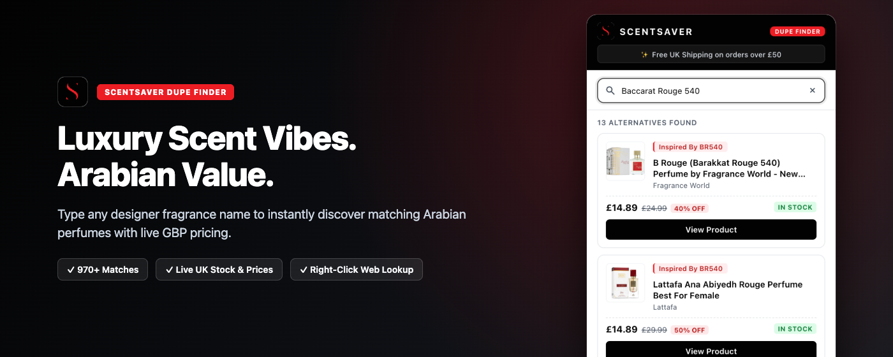
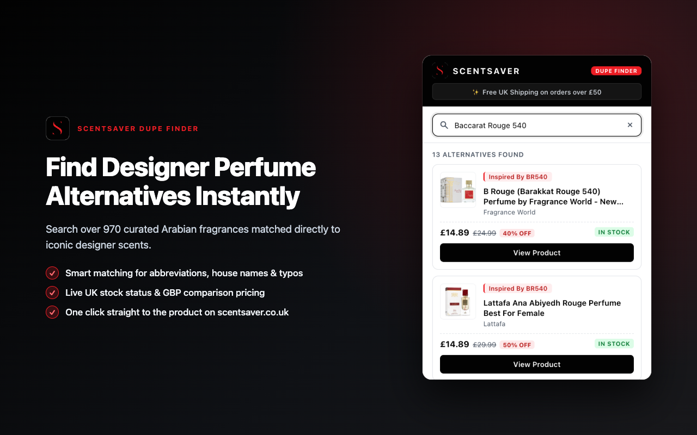
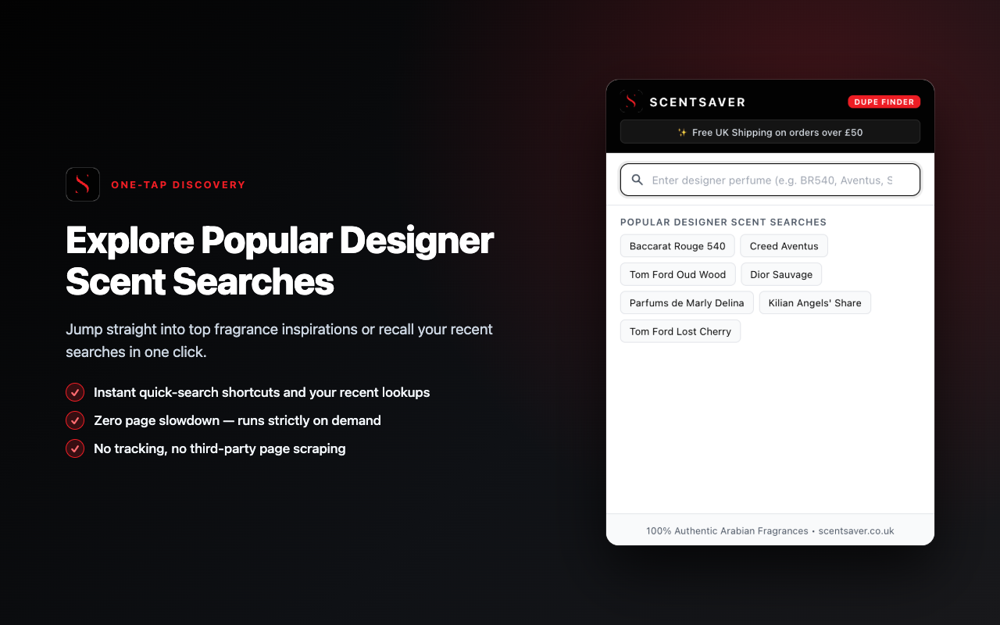
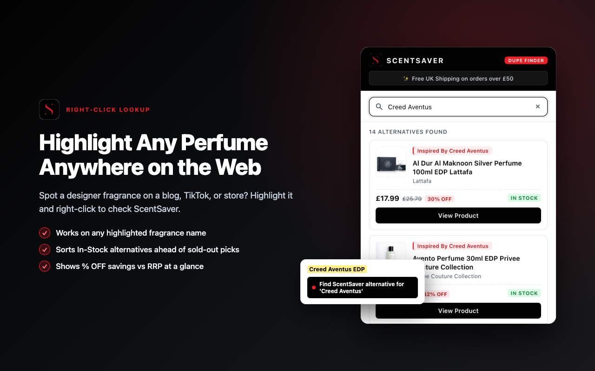

# ScentSaver — Arabian Perfume Alternative Finder

[](./manifest.json)
[](./LICENSE)
[](./tests)
[](https://scentsaver.co.uk)

**ScentSaver Dupe Finder** is a lightweight, privacy-first Chrome extension built for **[ScentSaver.co.uk](https://scentsaver.co.uk)** that helps fragrance shoppers find authentic Arabian-inspired perfume alternatives to luxury designer scents—complete with live UK stock status, GBP comparison pricing, and RRP savings percentages.

<p align="center">
  
</p>

---

## Screenshots

| Instant Fragrance Search | One-Tap Discovery & Shortcuts | Right-Click Web Lookup |
| :---: | :---: | :---: |
|  |  |  |

---

## Key Capabilities

- **Instant Local Search (~0ms)**: Bundles a pre-seeded catalog (`src/data/seedCatalog.json`, 973 curated fragrances) and syncs updates silently every 6 hours via `chrome.storage.local`.
- **Typo & Abbreviation Aware**: Expands common fragrance shorthand on word boundaries, strips filler concentration words, and handles minor spelling typos using Dice bigram similarity (`src/search/matcher.js`).
- **In-Stock Priority Ranking**: Always ranks available UK stock (`IN STOCK`) ahead of sold-out items (`OUT OF STOCK`) while surfacing clear RRP discount badges.
- **Staggered Live Price & Stock Check**: Refreshes live GBP pricing and stock availability for the top 3 visible results with `60s` memoization and automatic `HTTP 429` cooldown (`src/api/shopifyClient.js`).
- **Right-Click Context Menu Lookup**: Highlight any fragrance name on any webpage and right-click to open ScentSaver matches immediately (`src/background.js`)—no injected `content_scripts` and zero third-party page scraping.
- **Strict MV3 Content Security Policy**: Zero `innerHTML` usage; every card and chip is built safely using `document.createElement` and `textContent` (`src/ui/popup.js`).

---

## Permissions & Privacy

The extension asks only for the minimum permissions required to operate on demand:

| Permission | Scope | Purpose |
| :--- | :--- | :--- |
| `storage` | Local (`chrome.storage.local`) | Stores the 6-hour catalog cache, recent searches, and pending right-click query locally. |
| `contextMenus` | Selection menu only | Adds *"Find ScentSaver alternative for '...'"* when text is highlighted. |
| Host access | `https://scentsaver.co.uk/*` & subdomains | Fetches ScentSaver's public catalog data and verifies live GBP pricing/stock. |

No personal browsing history, analytics trackers, or third-party scripts are ever injected or collected.

---

## Repository Structure

```text
scentsaver-chrome-extension/
├── manifest.json       # Chrome Manifest V3 manifest
├── popup.html          # Extension popup layout
├── popup.css           # Crisp white + #020202 brand theme
├── assets/             # Extension icons (16, 48, 128 PNG) & SVG logo
├── src/
│   ├── background.js   # Selection context menu service worker
│   ├── api/            # Catalog sync, staggered live verification & URL helpers
│   ├── search/         # Normalization, alias dictionary & Dice fuzzy matcher
│   ├── ui/             # Safe DOM popup controller
│   └── data/           # Pre-seeded catalog snapshot
├── store-assets/       # Chrome Web Store screenshots & promotional tiles
├── tests/              # Node.js built-in test suites
├── llms.txt            # AI-readable project index for coding & search agents
└── LICENSE             # MIT License
```

---

## Local Installation (Chrome Developer Mode)

1. Clone this repository:
   ```bash
   git clone https://github.com/MTahsin77/scentsaver-chrome-extension.git
   ```
2. Open Chrome and visit `chrome://extensions/`.
3. Toggle **Developer mode** on in the top-right corner.
4. Click **Load unpacked** and select the cloned `scentsaver-chrome-extension` folder.
5. Pin **ScentSaver** from the Extensions toolbar menu.

---

## Running Tests

Requires **Node.js 18+** (uses the built-in `node:test` runner with zero external dependencies):

```bash
node --test tests/*.test.mjs
```

---

## Frequently Asked Questions

**Does this extension slow down websites I visit?**  
No. The extension uses zero `content_scripts` and injects nothing into webpages. It runs strictly on demand when you click the toolbar icon or use the right-click lookup menu.

**Does ScentSaver track my browsing activity?**  
No. Recent searches and the catalog cache stay local inside `chrome.storage.local`, and network requests are scoped strictly to `scentsaver.co.uk`.

**Where can I get support or review privacy terms?**  
- Official Store: [scentsaver.co.uk](https://scentsaver.co.uk)
- Customer Support: [scentsaver.co.uk/pages/contact](https://scentsaver.co.uk/pages/contact)
- Privacy Policy: [scentsaver.co.uk/policies/privacy-policy](https://scentsaver.co.uk/policies/privacy-policy)
